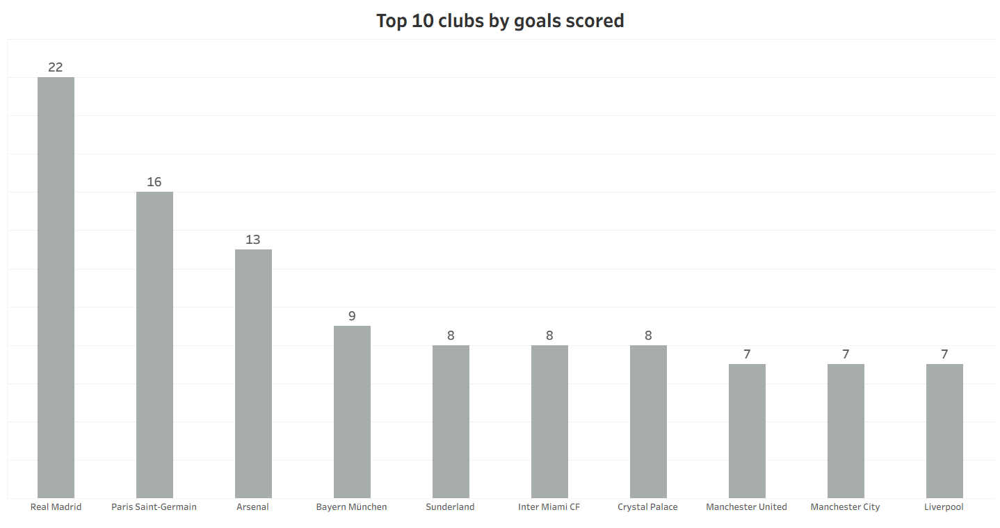
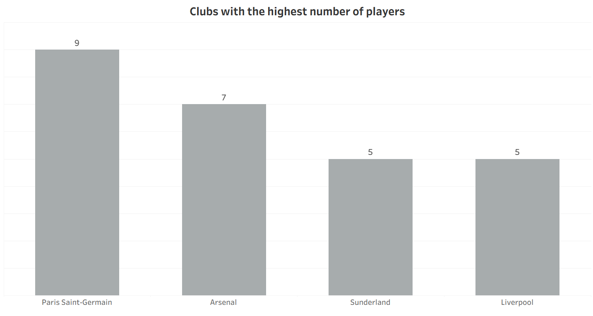
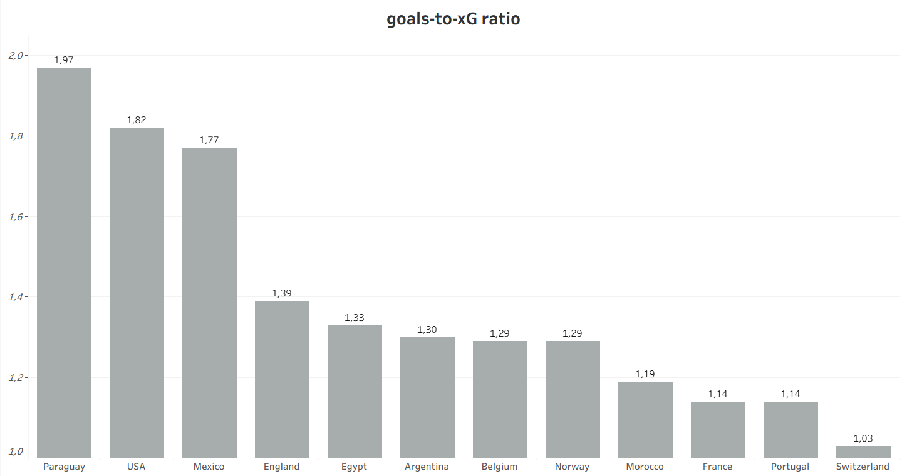
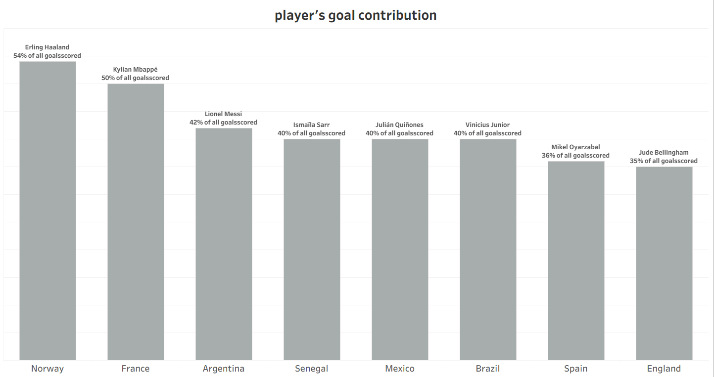
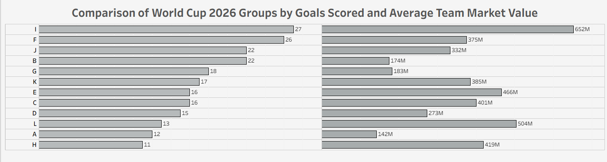
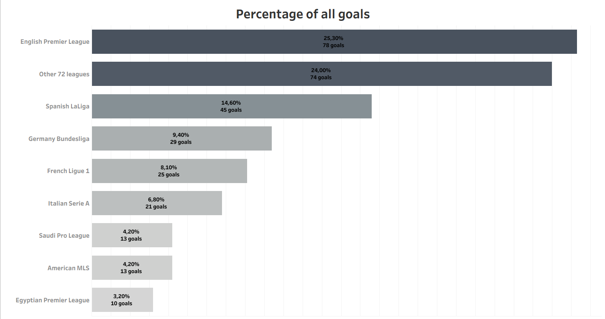
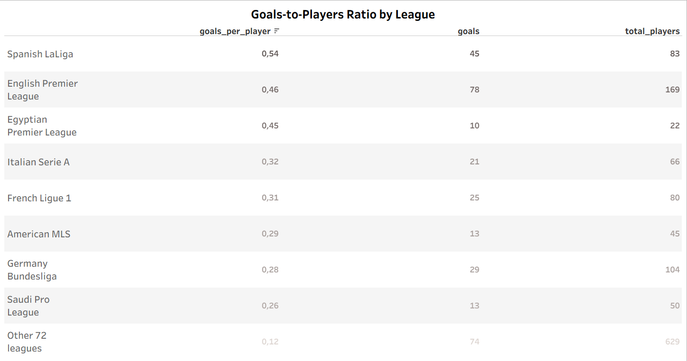
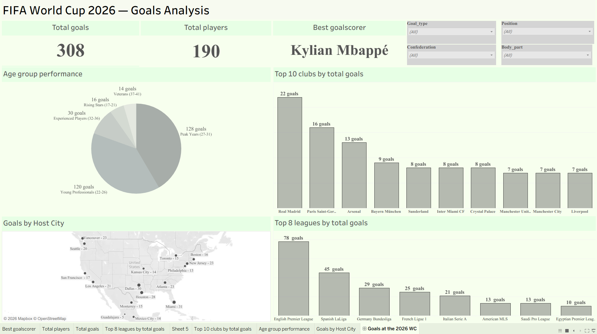

# FIFA World Cup 2026 — SQL Data Analysis

## Про проєкт

Цей проєкт присвячений аналізу даних Чемпіонату світу з футболу 2026 року за допомогою  SQL.

Основна мета — дослідити результативність команд і гравців, голи, футбольні ліги та матчі, а також виявити цікаві закономірності в даних турніру.

Аналіз зосереджений на голах, очікуваних голах (xG), внеску гравців, ринковій вартості команд і результативності футбольних ліг.

## Основні аналітичні питання

Проєкт дає відповіді на такі питання:

1. Гравці яких футбольних клубів забили найбільше голів?
2. Які команди забили більше голів, ніж очікувалося згідно з їхнім показником xG?
3. Яку частку загальної кількості голів команди забив її найкращий бомбардир?
4. Чи пов'язана ринкова вартість команди з її результативністю?
5. Які футбольні ліги забезпечили найбільшу кількість голів?
6. Як співвідносяться кількість голів і кількість гравців із кожної ліги?

## Інструменти та технології

* PostgreSQL
* SQL
* DBeaver
* Jupyter Notebook
* Python — для підключення до бази даних і відображення результатів SQL-запитів
* Tableau — для візуалізації даних
* GitHub

## Продемонстровані навички SQL

У проєкті продемонстровано практичне використання:

* `JOIN`
* `LEFT JOIN`
* `GROUP BY`
* Агрегатних функцій
* CTEs (Common Table Expressions)
* `UNION ALL`
* Віконних функцій
* Виразів `CASE`
* `HAVING`
* Очищення даних за допомогою `REGEXP_REPLACE`

## Основні напрямки аналізу

### Клуби з найбільшою кількістю голів

Визначення футбольних клубів, гравці яких забили найбільше голів протягом турніру.

Також аналіз показує кількість різних гравців кожного клубу, які забивали голи.

### Фактичні голи проти очікуваних (xG)

Порівняння фактичної кількості голів з очікуваною кількістю голів (xG) для кожної команди.

Це дає змогу визначити команди, які реалізовували свої гольові моменти ефективніше, ніж очікувалося.

### Внесок найкращого бомбардира

Визначення частки голів команди, забитих її найрезультативнішим гравцем.

Це допомагає виявити команди, результативність яких значною мірою залежала від одного основного бомбардира.


### Ринкова вартість команд і кількість голів

Порівняння ринкової вартості національних збірних із кількістю голів, забитих на груповому етапі.

Також аналіз порівнює середню ринкову вартість команд і загальну кількість голів між групами турніру.

### Внесок футбольних ліг у результативність

Ранжування футбольних ліг за кількістю голів, забитих їхніми гравцями.

Додатково розраховується кількість голів на одного гравця, щоб порівняти результативність гравців із різних ліг.


## Візуалізації

Наведені нижче візуалізації створені в Tableau на основі результатів SQL-аналізу.

### 1. Топ-10 футбольних клубів за кількістю голів

Показує футбольні клуби, гравці яких забили найбільше голів під час Чемпіонату світу з футболу 2026 року.



### 2. Клуби з найбільшою кількістю авторів голів

Показує, у яких клубах найбільша кількість різних гравців забивали голи.



### 3. Співвідношення голів до xG за командами

Порівнює фактичну кількість голів з очікуваними голами (xG) та визначає команди, які перевершили очікуваний рівень результативності.



### 4. Внесок найкращого бомбардира в голи команди

Показує, який відсоток голів команди забив її найкращий бомбардир.



### 5. Групи чемпіонату світу: голи та ринкова вартість команд

Порівнює загальну кількість забитих голів із середньою ринковою вартістю команд у кожній групі чемпіонату світу.



### 6. Частка голів за лігами

Показує, як розподіляються голи, забиті гравцями, між їхніми національними лігами.



### 7. Співвідношення голів до кількості гравців за лігами

Порівнює кількість забитих голів із кількістю представлених гравців у кожній лізі.




## Tableau Dashboard

### FIFA World Cup 2026 — Goals Analysis

Інтерактивний дашборд у Tableau для аналізу результативності гравців, футбольних клубів і ліг на Чемпіонаті світу 2026 року.

Дашборд містить:

- **3 KPI:** загальна кількість голів, кількість гравців та найкращий бомбардир.
- **4 візуалізації:** розподіл голів за віковими групами, топ футбольних клубів, географія забитих голів та результативність ліг.
- **4 інтерактивні фільтри:** тип гола, позиція гравця, конфедерація та частина тіла, якою забито гол.

### Data Preparation (SQL)

Для підготовки даних до візуалізації в Tableau було створено SQL-представлення `goal_analysis` у PostgreSQL.

За допомогою `LEFT JOIN` об'єднано дані про голи, гравців, збірні та матчі. Конструкція `CASE` використовується для визначення команди-суперника.

Підготовлений набір даних містить інформацію про авторів голів, асистентів, клуби, ліги, збірні та статистику матчів.

**SQL-запит:** [tableau_dashboard.sql](sql/tableau_dashboard.sql)

### Dashboard Preview



### Interactive Dashboard

[Переглянути інтерактивний дашборд у Tableau Public](https://public.tableau.com/views/WC2026_17854229159450/Goalsatthe2026WC)


## Дані

У проєкті використовуються чотири основні набори даних:

- `teams.csv` — national team information
- `matches.csv` — match statistics
- `players.csv` — player information
- `goals.csv` — individual goal records

### Джерела даних

Дані зібрано з відкритих джерел футбольної статистики:

- FIFA — інформація про турнір, команди, календар матчів і результати
- Transfermarkt — ринкова вартість гравців і команд
- FotMob — статистика матчів і гравців

Набори даних було зібрано та підготовлено спеціально для цього портфоліо-проєкту.

## Структура проєкту

```text
FIFA-World-Cup-2026-SQL-Analysis/
│
├── data/
│   ├── goals.csv
│   ├── matches.csv
│   ├── players.csv
│   ├── teams.csv
│   └── README.md
│
├── images/
│   ├── 01_top_clubs_by_goals.png
│   ├── 02_clubs_with_most_goal_scorers.png
│   ├── 03_goals_to_xg_ratio.png
│   ├── 04_top_scorer_contribution.png
│   ├── 05_groups_goals_vs_market_value.png
│   ├── 06_goals_share_by_league.png
│   ├── 07_goals_to_players_ratio_by_league.png
│   └── README.md
│
├── notebook/
│   ├── World_Cup_2026_SQL_Analysis.ipynb
│   └── README.md
│
├── sql/
│   ├── world_cup_analysis.sql
│   └── README.md
│
└── README.md
